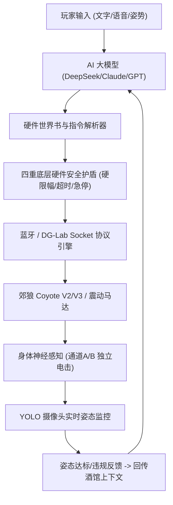

# ⚡ 幻触 (Phantouch) - 电击酒馆 (Electro-Tavern) 深度实操与调校手册

> **核心哲学**：将虚构角色扮演（SillyTavern 兼容）与物理世界真实神经电脉冲（EMS / TENS）双向打通。让 AI 不仅停留在冰冷的屏幕文本，更能在语境、调教、奖惩与规训中，直接触及你的感官中枢。

---

## 目录
1. [核心架构：电击酒馆是如何运作的？](#一核心架构电击酒馆是如何运作的)
2. [硬件连接与双通道控制体系](#二硬件连接与双通道控制体系)
3. [角色卡配置与硬件权限授予](#三角色卡配置与硬件权限授予)
4. [硬件世界书 (Hardware Lorebook) 与指令协议](#四硬件世界书-hardware-lorebook-与指令协议)
5. [YOLO 端到端姿态视觉闭环监控 (99.84% 精度)](#五yolo-端到端姿态视觉闭环监控-9984-精度)
6. [狂暴模式 (SeseBoosted) 与戏外指令 (OOC)](#六狂暴模式-seseboosted-与戏外指令-ooc)
7. [四重军规级安全护盾与生命保障](#七四重军规级安全护盾与生命保障)
8. [高频问题与排障指南 (FAQ)](#八高频问题与排障指南-faq)

---

## 一、核心架构：电击酒馆是如何运作的？

传统 AI 酒馆只能通过文本描述动作（例如 `*狠狠地电击你5秒*`），用户无法产生真正的体感反馈。  
**电击酒馆** 通过以下三大核心层，实现“语言心智 -> 神经脉冲 -> 身体姿态”的完整生命体闭环：



1. **心智层**：AI 根据你的对话态度、服从程度、人设剧情，决定是否对你施以奖励微电流或惩罚重击。
2. **执行层**：系统把 AI 的结构化指令（原生 tool calling，或硬件世界书的 `[[YCY_HW:…]]` 控制标记）转化为毫秒级的蓝牙脉冲数据包，驱动真实的电极片。
3. **视觉闭环层**：本地 YOLO 视觉模型持续检测你的实际身体姿势（如双膝正跪、叩拜、反剪双手、M字跪姿等），一旦偷懒变形，立即触发硬件电击追加惩罚！

---

## 二、硬件连接与双通道控制体系

电击酒馆深度支持国内外主流成人智能穿戴与 EMS 脉冲设备：

### 1. 郊狼 Coyote (爱感科技) V2 / V3 蓝牙原生直连
- **连接方式**：打开电脑或手机蓝牙，在 App 顶栏点击蓝牙图标搜索 `D-Lab Coyote`。
- **双通道独立调节**：
  - **A 通道**：可贴敷于腹部、大腿内侧或特定敏感部位，支持 0~200 级微步递增。
  - **B 通道**：可贴敷于会阴、臀部或背部，独立设定波形频率与脉宽。
- **24+ 款专业动态波形**：包含轻抚刺痒、针刺微麻、连续涌浪、呼吸心跳、抽蓄爆击、渐进浪涌等。

### 2. DG-Lab Socket 远程扫码桥接
- **适用场景**：异地情侣调教、手机 DG-Lab 官方 App 桥接。
- **使用方法**：
  1. 在手机上打开 DG-Lab 官方 App，进入“Socket 远程控制”并生成二维码。
  2. 在幻触中选择“DG-Lab Socket 模式”，点击扫码或输入 WebSocket 桥接地址。
  3. 建立安全握手后，AI 即可跨越地域限制远程下发真实电击。

### 3. 虚拟仿真演练模式 (Simulator)
- **零风险体验**：在未连接真实物理硬件前，系统内置了数字孪生仿真引擎。
- 界面会实时显示 A/B 通道电压电流波形动画、功率计仪表盘及模拟疼痛度。建议新手先在仿真模式下熟悉所有互动逻辑。

---

## 三、角色卡配置与硬件权限授予

并非所有角色都必须操控你的身体。电击酒馆设计了严格的**单卡硬件鉴权体系**：

### 1. 角色卡导入与兼容性
- 完美兼容 **SillyTavern** 标准角色卡（`.png` 嵌入元数据图片、`.json` 角色文件）以及 **Character Card V2** 规范。
- 支持角色独立设定专属 TTS 音色（Edge Neural、火山豆包 Seed TTS 2.0、硅基流动 CosyVoice2）。

### 2. 激活角色电击控制权限
在角色卡列表或酒馆右上角工具箱中：
1. 点开该角色的 **【⚡ 硬件支配已附魔 / 纯文字模式】** 开关。**默认状态**：外部导入的社区角色卡一律为「纯文字模式」（导入时强制关闭，且导出时也强制写回关闭）；5 张内置预设卡出厂为已附魔，可随时关闭。
2. **强度按全局设置、不按角色区分**。所有角色共用【系统设置 → 硬件安全】里的 `maxEmsStrengthA` / `maxEmsStrengthB`。想让某个角色"永远卡在 35 档之内"，请把这里的全局上限设成 35；当前版本**没有**"角色专属最高强度"字段。
3. **波形倾向**通过该角色卡的内置世界书条目（角色卡编辑 → 世界书），或全局 **硬件世界书**（酒馆 → 世界书 → 硬件）指定，可分别设置触发关键词、目标波形/律动、时长与「到时停止 / 持续输出」。
4. 任何时刻关闭第 1 步的开关，或点击顶栏红点撤销，都能立刻回到纯文本模式。

---

## 四、硬件世界书 (Hardware Lorebook) 与指令协议

系统底层内置了高度鲁棒的指令解析引擎，AI 无需复杂配置即可自然习得电击操控能力。

> [!IMPORTANT]
> **请勿编写 `<hardware>{...}</hardware>` 这类标签。** 当前版本没有任何该标签的解析器，文本清洗器反而会把它从可见回复里剥掉。真实的下发通道是下面两条。

### 1. 通道 A：原生 tool calling（支持函数调用的模型自动走这条）
系统向模型暴露 10 个工具，模型按剧情自行决定是否调用：

| 工具 | 作用 |
| :--- | :--- |
| `set_ems_strength` | 设置 `channel`（A/B/AB）强度 0–200，再经全局上限夹取 |
| `send_ems_wave` | 切换通道波形（24+ 款内置波形） |
| `set_toy_motor` | 三通道马达速率 0–20 |
| `toy_pattern` / `toy_turbo` / `toy_edge` | 律动模式、Turbo、边缘控射 |
| `enema_fill` / `enema_drain` / `enema_pattern` | 灌肠注水 / 排水 / 流程 |
| `emergency_stop` | AI 主动安全停止（不会激活全局急停锁） |
| `get_device_status` | 读取当前硬件状态 |

安全约束：最多 5 轮工具循环、单轮 ≤5 个、累计 ≤12 个；参数非法 JSON 不执行；`emergency_stop` 成功后本轮后续硬件指令全部忽略；**工具调用会缓冲到整段流式回复结束才执行**，避免半截 JSON 误触发硬件。

### 2. 通道 B：硬件世界书控制标记（DZMM 等无函数调用的通道）
App 每轮把命中的规则编号、**可用档位区间**与**最大时长**以白名单方式注入 System Prompt，并要求模型在回复末尾追加：

```
[[YCY_HW:<本轮随机token>:<规则ID>:<时长或运行标志>:<档位>]]
```

- `token` 每轮随机生成，旧标记无法重放；
- 时长与档位在解析时按用户设定夹取，标记本身在显示前被剥离；
- 档位区间直接来自你设置的安全上下限，**世界书无法越过玩家设置**。

### 3. 硬件世界书条目的字段
在【酒馆 → 世界书 → 硬件】里配置，每条包含：触发关键词（主 / 次）、触发来源（`用户` / `角色` / `两者`）、硬件动作类型（7 种）、EMS 波形或马达律动目标、`到时停止` 或 `持续输出`、以及 AI 可选的**最大时长**。同一轮内 EMS / 马达 / 灌肠三个通道各只会执行一条（按优先级与规则特异性排序），并受每条自身的冷却时间约束。
### 4. 实时状态 HUD 悬浮监控
酒馆顶部提供实时的 **角色支配 HUD** 监控条，四维数值均为 0–100，由模型每轮输出的隐藏状态标记更新（没有标记时按对话关键词兜底推断）：

- **好感度 (favor)**：默认 30，分初次相处 / 逐渐亲近 / 深度依恋 / 灵魂共鸣四阶段
- **服从度 (obedience)**：默认 20，分抗拒 / 试探 / 驯顺 / 绝对服从四阶段
- **快感值 (arousal)**：默认 0
- **羞耻度 (shame)**：默认 40
- 另有一个由四维数值推导的 **心境 (mood)** 徽章
- **当前实时输出**在顶栏设备状态区显示 A / B 通道的跳动数值

HUD 支持手动微调与一键重置，也支持 8 个"色气心境"快捷标签。数值按角色卡分别存档。

---

## 五、YOLO 端到端姿态视觉闭环监控 (99.84% 精度)

电击酒馆最革命性的突破在于引入了**物理姿态视觉闭环**！

### 1. 深度微调视觉模型
- 采用 YOLOv8 在专用姿态数据集上做显卡直通微调（AMD RX 9070 XT 硬件加速）。模型检查点自带 `metrics/accuracy_top1 = 0.99838`、`metrics/accuracy_top5 = 1.0`。
- 推理是**两阶段**：先用 `yolov8n-pose` 检测人体并裁紧选框，再送 12 类 CNN 分类，最后做贝叶斯软融合与骨骼先验否决。
- 注意：仓库里没有训练轮次日志，因此"78 轮 / 第 53 轮早停"这类具体轮次说法无法从产物核实（检查点内的 `train_args` 为 `epochs=80, patience=25`），本手册不再声称该数字。单帧耗时同样取决于显卡，请以你自己的实测为准。

### 2. 12 种核心姿势合规判定
| 动作编号 | 姿势标识 | 中文标准动作 | 典型应用场景 |
| :---: | :--- | :--- | :--- |
| **01** | `unknown` | 日常站立/活动 | 放松自由时间，非规训状态 |
| **02** | `dog` | 四足趴跪爬行 | 宠物小狗服从训练、地板爬行 |
| **03** | `kneel` | 双膝跪地直立 | 正式受训、聆听主人训话 |
| **04** | `kowtow` | 叩拜五体投地 | 极致求饶、额头贴地道歉 |
| **05** | `hands_up` | 双手抱脑后 | 受审罚站/罚跪，防自卫防反抗 |
| **06** | `surrender` | 双手高举投降 | 高举双手绝对屈服 |
| **07** | `fetal` | 侧卧抱膝蜷缩 | 侧卧封闭受惩、反思期 |
| **08** | `spread_eagle`| 大字型张开 | 仰面全开放大字形敞开受刑 |
| **09** | `seiza` | 下士正坐 | 日式传统严苛跪坐，臀压足跟 |
| **11** | `bound_kowtow`| 反剪束手伏首 | 双手背后锁死、伏首贴地 |
| **13** | `kneel_ears` | 双手揪耳跪立 | 认错受罚经典体罚姿态 |
| **15** | `m_kneel` | M字开腿跪姿 | 双腿大角度展开极端羞耻跪立 |

*(注：原 14 号姿势已彻底废弃删除；16~22 号姿势当前标记为训练中置灰)*

### 3. 视觉闭环联动逻辑
1. 角色要求：“在地上趴好，保持小狗爬姿势 5 分钟，敢起身就电你！”
2. 打开电脑或手机摄像头，连接 `ws://电脑IP:8000/ws`。
3. YOLO 引擎开始以每秒 20+ 帧监控：
   - 姿态保持为 `dog`：计时正常流逝，角色温和夸奖。
   - 姿态变为 `unknown`（偷懒起身）：视觉端立即发出违规信号，触发电击抽搐，同时对话注入提示：`[系统警报：用户未维持小狗姿势，已执行电击惩罚]`！

---

## 六、狂暴模式 (SeseBoosted) 与戏外指令 (OOC)

### 1. 狂暴模式 (SeseBoosted)
- 点击酒馆底部火焰按钮即可一键点燃。
- 界面化为极度沉浸的狂暴粉光呼吸动效。
- 自动解锁大模型对高强度调教、身体主导与极端支配叙事的深层上下文记忆，电击频率与互动语气全面升温。

### 2. 戏外指令 (OOC - Out Of Character)
- 当你被电得受不了，或者需要临时调整设备强度时，无需跳出酒馆。
- 开启 `(OOC)` 开关或在输入框以 `(OOC: ...)` 发送消息：
  - 例如：`(OOC: 电流太强了，先暂停一下，把A通道降到15档)`
  - AI 角色会暂时跳出戏内人设，以温柔而理性的系统守护者口吻安抚你，并自动调低硬件功率。

### 3. 双行自适应打字框
- 底部输入区已全面升级为自适应两行高度，长句表述更加舒畅，支持 `Enter` 极速发送、`Shift + Enter` 自由换行。

---

## 七、四重军规级安全护盾与生命保障

> [!CAUTION]
> **电击玩具不是医疗器械。安全永远凌驾于任何剧情与玩法之上！**

幻触系统在底层硬件驱动（`DeviceManager`）中强制植入了以下安全防线：

1. **绝对硬件限幅锁 (Hardware Ceiling Lock)**：
   - 在【系统设置 → 硬件安全】或【强度 → 控制 → 输出保护】中设定的 `maxEmsStrengthA` 与 `maxEmsStrengthB` 享有最高优先级。
   - 无论是 AI 的工具调用、世界书的控制标记、还是网络数据包，在进入蓝牙底层前都会被夹取（工具参数夹一次、执行时重读实时配置再夹一次、协议层再封顶一次）。
   - ⚠️ **出厂默认是 200 / 200，也就是"上限等于硬件本体"**。请务必主动下调到你自己的安全档位（例如 30），否则这条锁形同虚设。
2. **悬浮/吸顶全局物理急停 (Emergency Stop)**：
   - 右下角与顶栏常驻红色八角急停按钮；硬件活跃时右下角还会浮出更大的常驻按钮。
   - 单次点击即：作废全部排队写入 → 清除所有定时器 → 本地状态清零 → 向实体设备发送关断包（并在排队写清空后**再补发一次**，防止在途旧指令复活输出）→ 锁存 `emergencyLock`，拒绝后续指令直到手动解除。
3. **断连自动熔断**：
   - 蓝牙 `gattserverdisconnected` 或 DG-LAB Socket 断开时，立即清除全部输出与定时器并归零。
   - 回报超限看门狗：任一通道的设备回报强度超过当前上限，立即锁存全局急停（下调上限后的 3 秒内，不超过旧授权值的"残留回报"会被正确豁免，不会误锁）。
4. **单角色隔离与一键撤销**：
   - 随时可关闭当前角色的【硬件支配附魔】开关，立刻退回纯文本聊天模式。

> [!WARNING]
> **当前版本尚未实现的两项保护（请务必知悉）**
> - **没有周期性心跳超时看门狗**：熔断是*断连事件驱动*的。若系统静默挂起 WebView 导致链路假死却不触发断连事件，郊狼会保持在上一次的强度上。**不要在输出过程中让手机长时间离开前台。**
> - **工具调用路径没有单次输出时长上限**：硬件世界书条目在「到时停止」模式下一定会挂定时归零；但 AI 通过 `set_ems_strength` / `send_ems_wave` 工具调用时不会自动带时长。请始终把物理急停放在伸手可及处。
> - 另外，灌肠机的 `loop` 循环流程只有单步时长上限（`maxEnemaDurationSec`），没有流程总时长上限，需要手动停止。

---

## 八、高频问题与排障指南 (FAQ)

### Q1：为什么 AI 发送了电击指令，但硬件没有反应？
1. **检查角色授权**：确认该角色卡是否开启了 **【⚡ 硬件支配附魔】** 开关（社区导入卡默认是纯文字模式）。
2. **检查蓝牙连接**：确认顶栏设备状态显示为绿色"已连接"。
3. **检查安全上限**：确认【系统设置 → 硬件安全】里的通道上限没有被误设为 0（**任一通道为 0 都会让"随机强度"类玩法取到 0 而整体跳过**）。
4. **检查急停锁**：顶栏若显示"解除急停锁"，说明此前触发过哪怕一次超限或断连熔断，所有输出都会被拒绝，需要手动解除。
5. **检查输出时长**：AI 用工具调用下发的强度不会自动归零，若已过峰值请手动归零。

### Q2：重塑（特训营 / 芭比实验室等）里点了硬件却完全没感觉？
1. 重塑的任务**同时**声明电击（郊狼）与马达（榨精机）。**马达是可选项**：没接榨精机时，特训营会跳过马达提示并照常输出电击，页面会明确提示"已跳过可选外设"。
2. **只有郊狼没连**才会拦下任务并提示"该任务需要郊狼 EMS 设备"。
3. 郊狼 3.0（V3）的强度包必须携带波形强度切片才会真正输出，因此"强度已经写进去但波形没跟上"的表现就是完全无感。v1.1.1 起 `setEmsStrength` 会立刻补一帧真实波形，不再依赖 100ms 的流式循环时序。
4. 如果设备齐备仍然无感，请回到 Q1 逐项排查，并优先确认急停锁状态。

### Q3：如何配合手机在床上进行姿势检测与电击受训？
1. 电脑端双击运行 `yolo_server_kit` 下的 `一键启动YOLO视觉服务.bat`（等价别名 `一键启动姿势分类服务.bat`）。
2. 手机浏览器打开幻触网页，进入【姿态受训】页面。
3. 输入电脑的局域网 WebSocket 地址：`ws://<电脑局域网IP>:8000/ws` 并点击连接。
4. 将手机摄像头对准全身，即可躺在床上享受无线的声、光、电、姿态闭环受训！

### Q4：如何备份我的角色卡、对话和自定义电击设置？
- 进入【设置 → 数据管理】，点击"导出全量备份包"。系统会自动打包所有角色世界书、对话历史、玩家预设与调教记录（自动脱敏 API Key）。
